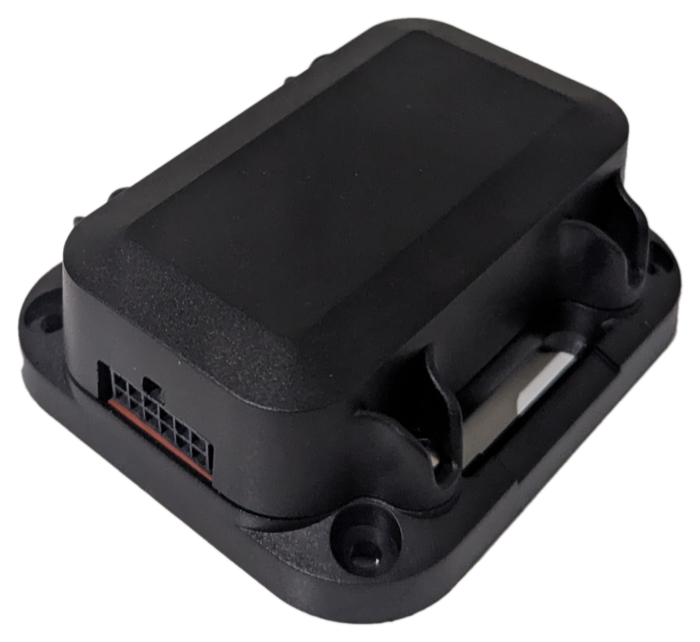

<p align="center">
  <a href="https://reactiot.com.au">
    <picture>
      <source media="(prefers-color-scheme: dark)" srcset="docs/assets/reactiot-logo-dark.svg">
      
    </picture>
  </a>
</p>

# GX5s Logger

Documentation and bench tools for the **GX5s Logger Development Board** (board version `v2106200`), an ESP32-S based IoT/vehicle logger.

<p align="center">
  
</p>

## Board at a glance

- ESP32-S MCU (16 MB flash) with 1 GB onboard SD NAND
- 9–36 V external supply, ignition/voltage detection, external interrupt/wake
- Molex 2x6 Micro-Fit 3.0 harness: power, UART, I2C, CAN 2.0B
- Mini PCIe modem slot with MFF2 eSIM
- USB-C service port via CP2102 USB-UART bridge
- MPU-6050 motion sensor, PCF8563 RTC, TCA9555 GPIO expander
- LiPo charging, status LEDs

## Repository layout

| Path | Contents |
|---|---|
| [`docs/gx5s-board-spec.md`](docs/gx5s-board-spec.md) | Full board specification: interfaces, pinouts, buses, open items |
| [`docs/components/`](docs/components/) | Per-component notes (ESP32 module, flash, RTC, IMU, GPIO expander, modem, USB) |
| [`docs/references/`](docs/references/) | Schematic PDF and component datasheets |
| [`tools/`](tools/) | Bench tools, e.g. [`esp32_mac_monitor.py`](tools/README.md) for reading board MACs |

## Quick start: read a board's MAC

```sh
cd tools
python3 -m venv .venv
.venv/bin/python -m pip install esptool
python3 esp32_mac_monitor.py --once
```

See [`tools/README.md`](tools/README.md) for all options.
