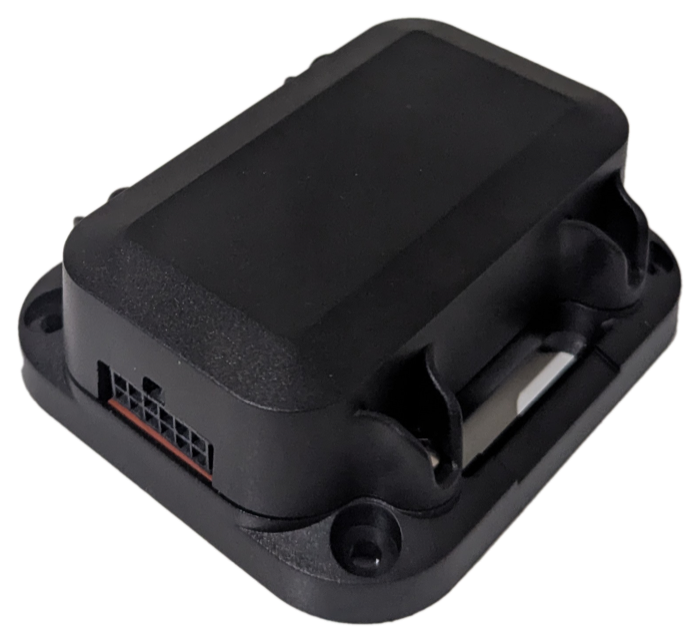

<p align="center">
  <a href="https://reactiot.com.au">
    <picture>
      <source media="(prefers-color-scheme: dark)" srcset="docs/assets/reactiot-logo-dark.svg">
      
    </picture>
  </a>
</p>

# GX5s Logger

Documentation and bench tools for the **GX5s Logger Development Board** (board version `v2106200`), an ESP32-S based IoT/vehicle logger.

<p align="center">
  
</p>

## Board at a glance

- ESP32-S MCU (16 MB flash) with 1 GB onboard SD NAND
- 9–36 V external supply, ignition/voltage detection, external interrupt/wake
- Molex 2x6 Micro-Fit 3.0 harness: power, UART, I2C, CAN 2.0B
- Mini PCIe modem slot with MFF2 eSIM
- USB-C service port via CP2102 USB-UART bridge
- MPU-6050 motion sensor, PCF8563 RTC, TCA9555 GPIO expander
- LiPo charging, status LEDs

## Repository layout

| Path | Contents |
|---|---|
| [`docs/gx5s-board-spec.md`](docs/gx5s-board-spec.md) | Full board specification: interfaces, pinouts, buses, open items |
| [`docs/components/`](docs/components/) | Per-component notes (ESP32 module, flash, RTC, IMU, GPIO expander, modem, USB) |
| [`docs/references/`](docs/references/) | Component datasheets |
| [`fw/`](fw/) | Base firmware (ESP-IDF 6.x): application in `main/`, one component per device in `components/` |
| [`tools/`](tools/) | Bench tools, e.g. [`esp32_mac_monitor.py`](tools/README.md) for reading board MACs |

## Base firmware

Open-source base firmware for the board: ESP-IDF 6.x, event driven, MQTT through the
cellular modem (Quectel BG96 `AT+QMT*`), built to never drain the vehicle battery.
The production broker is provisioned over the air; only a bootstrap broker is compiled in.
Design and power-state table: [`docs/adr/0001-base-firmware.md`](docs/adr/0001-base-firmware.md).

```sh
. ~/esp/v6.1.1/esp-idf/export.sh
cd fw
idf.py menuconfig          # "GX5s application" and "Component config > GX5s …": broker, APN, cutoff, pins
idf.py build flash monitor
cc -Icomponents/gx5_proto/include test/test_parse.c -o test/test_parse && test/test_parse   # host checks
cc -Icomponents/gx5_proto/include test/test_can.c -o test/test_can && test/test_can
cc -Icomponents/gx5_proto/include test/test_motion.c -lm -o test/test_motion && test/test_motion
```

| Component | What it is |
|---|---|
| `main` | The application: power states, ignition, supply protection, telemetry |
| `gx5_core` | Board pins and the event bus every component posts to |
| `gx5_proto` | Header-only parsers and CAN protocol logic (host-tested, no ESP-IDF) |
| `gx5_modem` | BG96 AT engine, MQTT, broker provisioning, GNSS |
| `gx5_io` | TCA9555 expander, MPU-6050 motion wake, PCF8563 RTC |
| `gx5_store` | Offline telemetry queue on the SD NAND |
| `gx5_can` | CAN driver, request scheduler, OBD-II / J1939 |
| `gx5_ext` | External UART on the harness: lines in, lines out, `gx5 ping` wiring check |

Components do not call each other; only `main` wires them together.

| Topic | Direction | Payload |
|---|---|---|
| `discovery/<mac>` (`<mac>` = device id `AA:BB:CC:DD:EE:FF`, factory MAC + 3) | device → bootstrap broker | `{"id":"<mac>","fw":"<ver>","reason":"unprovisioned"}` (or `broker-unreachable`) |
| `device/<mac>/<loc>/status/connected` | device → broker, retained | `online`, `provisioning`, `sleep`, `protect`, `offline` (last will) |
| `device/<mac>/<loc>/event` | device → broker | `{"id","fw","reason":"broker-changed"}` or `broker-change-failed`; driving events `{"ts":…,"ev":"brake","mg":520}` (`accel`, `brake`, `left`, `right`, `harsh`) |
| `device/<mac>/<loc>/telemetry` | device → broker | `{"ts":1794745845,"ign":1,"vcc_mv":12850,"bat_mv":4100,"ext":1,"chg":0,"can":1532,"wake":"timer","up_s":42,"acc":[12,-30,1004],"temp":31.5,"gyro":[0.4,-1.2,0.1],"lat":-33.86785,"lon":151.20732,"kmh":48.6,"cog":113.48,"sat":9}` |
| `device/<mac>/<loc>/can` | device → broker | changed CAN values: `{"ts":…,"obd":["7E8 01 0C 1AF8"]}` or `{"ts":…,"j1939":["FEEE 00 8C7DFFFFFFFFFFFF"]}` |
| `device/<mac>/<loc>/ext` | device → broker | each line received on the external UART (harness SAT pins) |
| `device/<mac>` and `location/<loc>` | broker → device, QoS 1 | `{"provision":{"pop":"14720943","broker":{"host":"…","port":8883,"user":"…","pass":"…","tls":true},"config":{"location":"0001","can":{"mode":"obd2","bitrate":500000}}}}` provisions; anything else is answered with telemetry |

`<loc>` is the location id: `0000` until provisioning sets `config.location` (1-9 of
`A-Z a-z 0-9 _ -`). A command sent to `location/<loc>` reaches every device at that location.

Provisioning: a new device connects to the bootstrap broker anonymously (no username or
password, client id = device id) and announces itself on
`discovery/<mac>`. Publish the provisioning message to `device/<mac>`. `pop` is the device's
PIN: the last three bytes of its id as one decimal number, 8 digits (`C4:DD:57:E0:9F:AF` →
`14720943`), also shown in the startup banner. With the right PIN the device applies `config`,
tries the new broker immediately and stores it only if it connects; with a wrong one it changes
nothing and publishes `provision-rejected`. The same message on the production broker moves the
device again. After `GX5_PROVISION_AFTER_FAILS` failed connects it checks
back with the bootstrap broker. `idf.py erase-flash` returns a device to unprovisioned.

Firmware update: `{"cmd":"ota","version":"1.4.2"}` (no version = `latest`) on a command topic.
The modem fetches `<GX5_OTA_URL>/fw/<hardware id>-<version>.bin` (default
`http://ota.reactiot.com.au`), the device writes it to its second app slot, restarts and
reports `{"ev":"ota","version":"…","result":"ok"}` (or the reason it failed) on `event`.

The clock comes from the RTC at boot and is corrected from network time whenever the cell
is up and from GPS time on every fix; all times are UTC.

CAN is configured over the command topic and kept across reboots:

```json
{"can":{"mode":"obd2","bitrate":500000}}
{"can_req":{"slot":0,"id":"7DF","data":"02010C","interval":10}}
{"can":{"mode":"j1939","bitrate":250000,"filter":true}}
{"can_req":{"slot":0,"id":"18EA00F8","data":"EEFE00","interval":30}}
```

Modes are `off`, `listen` (default, never transmits), `obd2` and `j1939`; the last two
acknowledge and transmit on the vehicle bus. `interval` 0 clears a slot.

**Factory reset:** press reset (or cycle power) five times, each within about 5 seconds of
the last. The stored broker, CAN configuration and offline queue are erased, the power LED
blinks five times and the device announces itself for provisioning again.

Behaviour:

- **Ignition on** — connected, telemetry every `GX5_TELEMETRY_S` with a GNSS fix; CAN requests sent and changed values published.
- **Ignition off** — connect, report, stay `GX5_LINGER_S`, then deep sleep with the modem still
  registered. Wakes on ignition, motion (MPU-6050), modem RI (e.g. an SMS) or every `GX5_HEARTBEAT_S`; commands
  sent meanwhile are queued by the broker (persistent session).
- **Offline** — telemetry is queued on the SD NAND with an RTC timestamp and replayed when the broker is back.
- **Supply below `GX5_VCC_CUTOFF_MV`** — modem powered down, deep sleep, supply re-measured every
  `GX5_PROTECT_RECHECK_S`; resumes above cutoff + `GX5_VCC_HYST_MV`.

TLS is terminated in the modem: upload the broker CA once (`AT+QFUPL="cacert.pem",<size>`), or
set `GX5_MQTT_TLS_SECLEVEL=0` for an unauthenticated (insecure) link while testing.

### Bench tests (Raspberry Pi + CAN tester hat)

`fw/test/bench/` runs the firmware against real hardware: the Pi hat switches the board's
supply and ignition, measures its current and sends CAN frames; the console comes through
[ESP32 Workbench](https://github.com/react-iot/esp32-workbench) on the Pi.

Long runs: `soak.py` on the same Pi logs the supply current once a second and every boot
(wake cause, reset reason), sleep and fault from the console to `~/gx5s-soak`, with a
10-minute ignition cycle every 6 hours. `sudo systemctl start gx5s-soak` starts it,
`python3 soak.py report` summarises; stop it before running pytest (both drive the hat).

```sh
scp fw/test/bench/* can-workbench:gx5s-bench/
ssh can-workbench 'sudo bash gx5s-bench/setup-pi.sh && sudo reboot'    # once
idf.py -p 'rfc2217://<pi-address>:4001' -b 115200 flash                # from fw/, flashes over the network
ssh can-workbench 'cd gx5s-bench && python3 -m pytest -s test_bench.py'   # about 5 minutes
```

## Quick start: read a board's MAC

```sh
cd tools
python3 -m venv .venv
.venv/bin/python -m pip install esptool
python3 esp32_mac_monitor.py --once
```

See [`tools/README.md`](tools/README.md) for all options.
